# Generic Sudoku Solver & Interactive Visualizer — The Art of Logic

An editorial-grade, publication-ready **Sudoku Solver** and **Interactive Step-by-Step Visualizer** built around **bitmask candidate tracking**, **worklist-driven constraint propagation** (_Naked Singles_ & _Hidden Singles_), the **Minimum Remaining Values (MRV)** heuristic, **fail-fast contradiction detection**, and **LIFO-undo recursive backtracking**.

Designed to be walked through live with colleagues or studied independently — every concept below is explained **from the ground up**, with **real step-by-step examples** and **custom diagrams** pulled directly from the solver's actual execution traces.

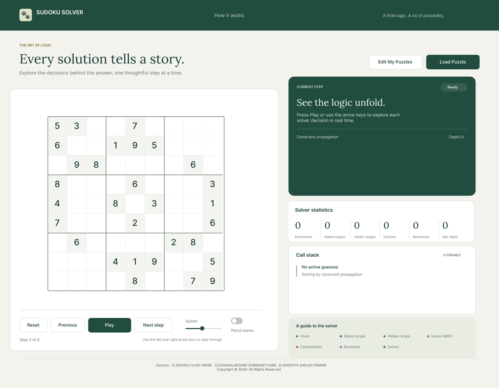

---

## Table of Contents

1. [Start Here: Basic Terms Explained Simply](#1-start-here-basic-terms-explained-simply)
2. [Foundation: Bitmasks — Storing 9 Possibilities in One Integer](#2-foundation-bitmasks--storing-9-possibilities-in-one-integer)
3. [Methodology 1: Naked Singles (Cell-Level Deduction)](#3-methodology-1-naked-singles-cell-level-deduction)
4. [Methodology 2: Hidden Singles (Unit-Level Deduction)](#4-methodology-2-hidden-singles-unit-level-deduction)
5. [Methodology 3: Worklist-Driven Constraint Propagation](#5-methodology-3-worklist-driven-constraint-propagation)
6. [Methodology 4: Minimum Remaining Values (MRV) Heuristic](#6-methodology-4-minimum-remaining-values-mrv-heuristic)
7. [Methodology 5: Dual Contradiction Detection (Fail-Fast)](#7-methodology-5-dual-contradiction-detection-fail-fast)
8. [Methodology 6: Recursive Backtracking & the LIFO Undo Log](#8-methodology-6-recursive-backtracking--the-lifo-undo-log)
9. [Under the Hood: All 11 Core Algorithmic Optimizations](#9-under-the-hood-all-11-core-algorithmic-optimizations)
10. [End-to-End Architecture & Puzzle Benchmarks](#10-end-to-end-architecture--puzzle-benchmarks)
11. [Repository Files, Authors & How to Run](#11-repository-files-authors--how-to-run)

---

## 1. Start Here: Basic Terms Explained Simply

Before looking at solving algorithms, let's make sure every single term is crystal clear — even for someone who has never written a Sudoku solver before.

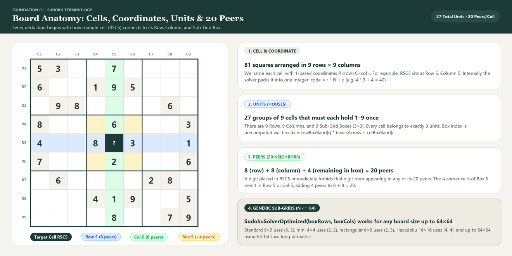

### Plain-English Glossary

| Term                          | What It Means (No Jargon)                                                                                                                                                    | In Our Code                                                           |
| ----------------------------- | ---------------------------------------------------------------------------------------------------------------------------------------------------------------------------- | --------------------------------------------------------------------- | --- | ---------------------- |
| **Cell**                      | One single square on the Sudoku board (81 squares in a standard 9×9 puzzle).                                                                                                 | Encoded as `code = row * n + col` (0 to 80).                          |
| **Coordinate (`R5C5`)**       | A human-friendly address: **R**ow 5, **C**olumn 5 (1-based for humans; 0-based `row=4, col=4` in code).                                                                      | `cellRowTable[code]`, `cellColTable[code]`                            |
| **Given (Clue)**              | A starting digit provided by the puzzle that cannot be changed.                                                                                                              | Marked immediately via `markUsed(...)` and skipped in the empty list. |
| **Empty Cell**                | A blank square (`0` or `.`) that the solver needs to fill.                                                                                                                   | Linked in `emptyPrev[]` / `emptyNext[]` doubly linked list.           |
| **Unit (House)**              | Any group of `N` cells that must contain digits `1` through `N` exactly once. A 9×9 board has **27 units**: 9 Rows, 9 Columns, and 9 Boxes (3×3 sub-grids).                  | `UNIT_ROW = 0`, `UNIT_COL = 1`, `UNIT_BOX = 2`                        |
| **Peer**                      | Any cell that shares at least one unit (Row, Column, or Box) with a target cell. Every cell has **20 peers**: 8 in its row + 8 in its column + 4 remaining cells in its box. | Enqueued by `enqueuePeers(row, col, ...)`                             |
| **Candidate (Pencil Mark)**   | A digit that is still legally allowed in an empty cell because none of that cell's 20 peers have used it yet.                                                                | Returned by `candidateMask(row, col)`                                 |
| **Constraint Propagation**    | Automatically filling forced cells whenever earlier placements narrow down the remaining choices — like knocking over dominoes, **with zero guessing**.                      | `propagate(...)`                                                      |
| **Fixed Point**               | The moment propagation stops finding any new forced moves (`cellQueue` and `unitQueue` are both empty).                                                                      | Loop exit of `while (!cellQueue.isEmpty()                             |     | !unitQueue.isEmpty())` |
| **Heuristic**                 | A smart rule of thumb for making a choice when logic alone isn't enough.                                                                                                     | `findBestCell()` using MRV                                            |
| **Contradiction**             | Proof that the current board state is impossible (either a cell has 0 legal digits left, or a unit has nowhere left to place a needed digit).                                | Returns `false` immediately from `propagate()`                        |
| **Backtracking**              | Rewinding a wrong guess back to the last decision point and trying the next option instead.                                                                                  | `unplace(...)` + `undo(board, log)`                                   |
| **Call Stack & Depth**        | The chain of active guesses currently being tested. **Depth 0** = pure logic (0 guesses). **Depth 1** = 1 active guess, **Depth 2** = a guess inside a guess, and so on.     | `guessStack` in `SudokuVisualizer.html`                               |
| **LIFO (Last-In, First-Out)** | Undoing changes in the **exact reverse order** they were made (just like taking plates off the top of a stack).                                                              | Reverse loop in `undo(board, log)`                                    |
| **O(1) vs O(N²)**             | **O(1)** means "constant time — always takes the same few steps regardless of board size." **O(N²)** means "must scan the whole `N × N` board (e.g. all 81 cells)."          | Bitmasks & linked lists replace O(N²) scans with O(1) ops             |

### Upfront Validation (`isValidBoard` & `findConflicts`)

Before solving begins, the solver checks two things:

1. **Dimensions**: The board must be `N × N` where `N = boxRows * boxCols` and `N <= 64` (so any sub-grid like `2×2`, `2×3`, `3×3`, `4×4`, up to `8×8` works in `SudokuSolverOptimized`).
2. **No Duplicate Clues**: No row, column, or box may already contain the same digit twice. For instance, the built-in **Invalid Test** puzzle puts two `5`s in Row 1 (`R1C1 = 5` and `R1C2 = 5`). `isValidBoard()` catches this immediately in a single pass and rejects the board before running any search.

---

## 2. Foundation: Bitmasks — Storing 9 Possibilities in One Integer

### The Problem with Naive Approaches

If you ask a computer _"Which digits are still allowed in cell `R5C5`?"_, a beginner implementation creates a `boolean[10]` array or `HashSet<Integer>` and loops through all 20 peers every time. Doing that thousands of times creates memory garbage and wastes CPU cycles.

### How a Bitmask Solves This

A **bitmask** packs a whole yes/no checklist into the binary `1`s and `0`s of a single integer (`long` in Java, giving 64 bits — enough for boards up to `64 × 64`!).

Each digit `d` (`1` through `9`) is assigned **bit position `d - 1`** via `1L << (d - 1)`:

- Digit `1` → bit `0` (`000000001` = `1`)
- Digit `2` → bit `1` (`000000010` = `2`)
- ...
- Digit `5` → bit `4` (`000010000` = `16`)
- ...
- Digit `9` → bit `8` (`100000000` = `256`)
- All 9 digits (`fullMask`) → `0b111111111` = `0x1FF` = `511`.

The solver keeps just **three tiny arrays** for the entire board:

- `rowUsed[r]` — which digits are already placed in row `r`
- `colUsed[c]` — which digits are already placed in column `c`
- `boxUsed[b]` — which digits are already placed in box `b`

### Real Example: Computing Candidates for `R5C5` in `Easy (Classic)`

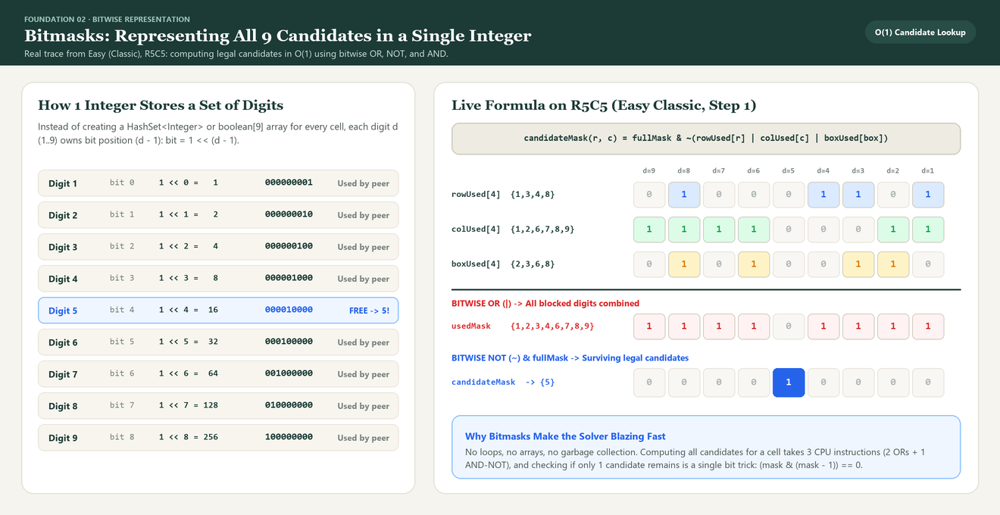

Look at cell `R5C5` (`row = 4, col = 4, box = 4`) at Step 0 of **Easy (Classic)**:

1. `rowUsed[4]` has `{1, 3, 4, 8}` → binary `010001101`
2. `colUsed[4]` has `{1, 2, 6, 7, 8, 9}` → binary `111100011`
3. `boxUsed[4]` has `{2, 3, 6, 8}` → binary `010100110`

Combine all blocked digits with **bitwise OR (`|`)**, then flip the bits with **bitwise NOT (`~`)** and mask to 9 bits (`fullMask & ...`):

```java
long mask = fullMask & ~(rowUsed[row] | colUsed[col] | boxUsed[boxIndex(row, col)]);
```

- `rowUsed[4] | colUsed[4] | boxUsed[4]` = `111101111` (`{1, 2, 3, 4, 6, 7, 8, 9}` are blocked)
- `fullMask & ~111101111` = **`000010000`** → **only bit 4 (Digit `5`) is `1`!**

That took **3 CPU instructions** instead of 3 loops.

---

## 3. Methodology 1: Naked Singles (Cell-Level Deduction)

> **Core Question:** _"Looking at this ONE empty cell, how many digits are still legally possible?"_
> If the answer is **exactly 1**, that digit is a **Naked Single** — it is standing out in the open with no other candidates beside it.

### Step-by-Step Real Example: `Easy (Classic)`, Step 1 — `R5C5 = 5`

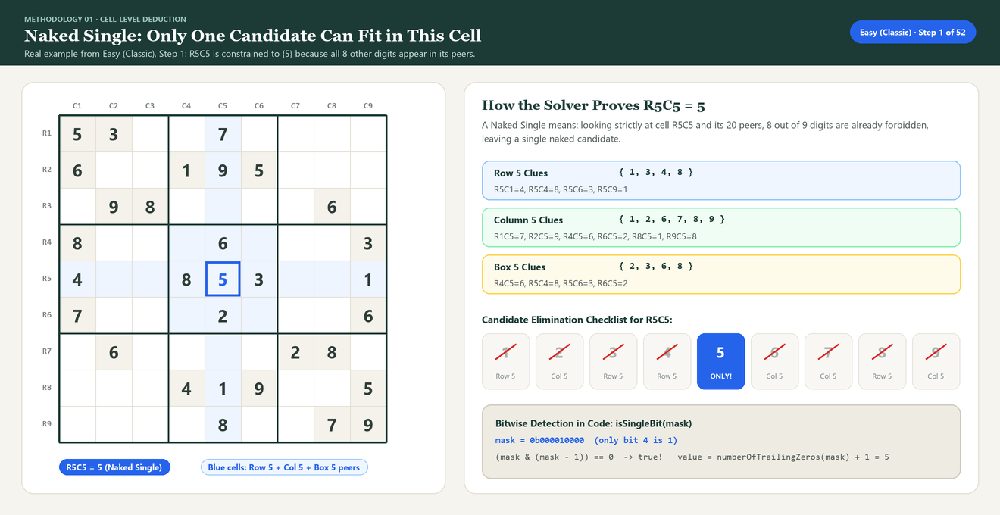

1. **Inspect `R5C5`'s 3 Units:**
   - **Row 5** already contains `{1, 3, 4, 8}` (`R5C1=4, R5C4=8, R5C6=3, R5C9=1`).
   - **Column 5** already contains `{1, 2, 6, 7, 8, 9}` (`R1C5=7, R2C5=9, R4C5=6, R6C5=2, R8C5=1, R9C5=8`).
   - **Box 5** reinforces `{2, 3, 6, 8}`.
2. **Eliminate Digits `1–9`:**
   - `1, 2, 3, 4, 6, 7, 8, 9` all appear in at least one peer of `R5C5`.
   - Only **`5`** remains!
3. **How the Code Detects This in O(1):**
   ```java
   if (isSingleBit(mask)) { // (mask != 0L && (mask & (mask - 1)) == 0L)
       int value = Long.numberOfTrailingZeros(mask) + 1; // 4 trailing zeros + 1 = 5
   }
   ```
   **Why `mask & (mask - 1) == 0` works:** Subtracting `1` from a power of two (like `000010000 - 1 = 000001111`) flips its single `1` bit to `0` and all lower `0`s to `1`, so bitwise AND gives `0`. If two or more bits are `1`, the highest `1` bit stays untouched and the result is non-zero!

---

## 4. Methodology 2: Hidden Singles (Unit-Level Deduction)

> **Core Question:** _"Looking across an entire Row, Column, or 3×3 Box, is there a missing digit that can fit into ONLY ONE cell in that unit?"_

### Why Is It Called "Hidden"?

Sometimes a cell still has **2, 3, or 4 legal candidates** (so Naked Single skips right over it), **yet** one of its candidates cannot legally go anywhere else in that Row, Column, or Box! That lone valid home is _hidden_ among the cell's other pencil marks until you scan the whole unit.

### Step-by-Step Real Example: `Medium`, Step 3 — `R5C1 = 7` in Column 1

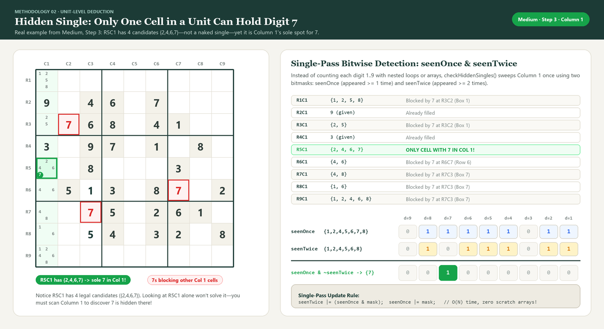

After Steps 1 and 2 place `R6C3 = 1` and `R8C3 = 5`, **no Naked Singles remain** anywhere on the board. Look closely at **Column 1** (`C1`):

1. `R2C1 = 9` and `R4C1 = 3` are already filled.
2. What about the remaining 7 empty cells in Column 1?
   - `R1C1`: `{1, 2, 5, 8}` — `7` is blocked by `R3C2 = 7` (same Box 1)
   - `R3C1`: `{2, 5}` — `7` is blocked by `R3C2 = 7` (same Box 1)
   - **`R5C1`: `{2, 4, 6, 7}` — has 4 candidates, including `7`!**
   - `R6C1`: `{4, 6}` — `7` is blocked by `R6C7 = 7` (same Row 6)
   - `R7C1`: `{4, 8}` — `7` is blocked by `R7C3 = 7` (same Box 7)
   - `R8C1`: `{1, 6}` — `7` is blocked by `R7C3 = 7` (same Box 7)
   - `R9C1`: `{1, 2, 4, 6, 8}` — `7` is blocked by `R7C3 = 7` (same Box 7)
3. **Conclusion:** Even though `R5C1` has 4 possible candidates `{2, 4, 6, 7}`, **no other cell in Column 1 can hold `7`**. Therefore, `R5C1` **must** be `7`!

### How `checkHiddenSingles()` Finds ALL Hidden Singles in One Pass (`seenOnce` / `seenTwice`)

Instead of looping 9 times (once per digit `1..9`) or allocating scratch count arrays, the solver sweeps the unit **once** using two bitmasks:

```java
long seenOnce = 0L;
long seenTwice = 0L;
for (int i = 0; i < cells.length; i++) {
    // ... compute candidate mask for empty cell i ...
    seenTwice |= (seenOnce & mask); // Bit becomes 1 if seen before AND seen again now
    seenOnce  |= mask;              // Bit becomes 1 if seen in at least 1 cell
}
long hiddenSingles = seenOnce & ~seenTwice; // Appeared in EXACTLY ONE cell!
```

On Column 1 at Step 2:

- `seenOnce` = `{1, 2, 4, 5, 6, 7, 8}` (`011111011`)
- `seenTwice` = `{1, 2, 4, 5, 6, 8}` (`010111011`)
- `seenOnce & ~seenTwice` = **`{7}` (`001000000`)** → Bit 6 (`7`) appeared **once and never twice**! The solver finds the matching cell (`R5C1`) and places `7`.

---

## 5. Methodology 3: Worklist-Driven Constraint Propagation

A naive solver checks all 81 cells and all 27 units in a giant loop after every single placement — doing mostly redundant work on unaffected squares. Our solver uses **targeted worklist propagation**.

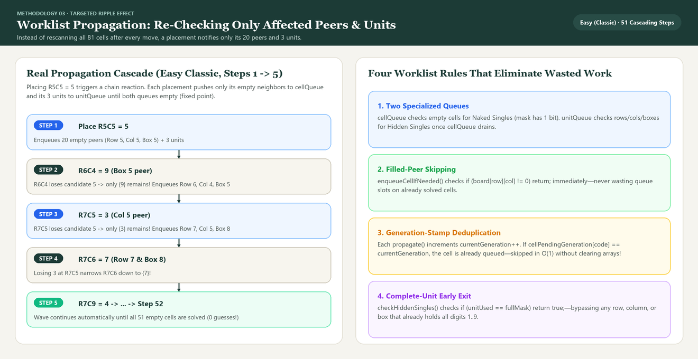

### How the Ripple Effect Works

Whenever a digit is placed at `(row, col)`:

1. **Only its empty peers** (at most 20 cells in Row `row`, Col `col`, and Box `boxIndex(row, col)`) could possibly have lost a candidate — so **only those empty peers** are pushed onto `cellQueue`.
2. **Only its 3 units** (`UNIT_ROW`, `UNIT_COL`, `UNIT_BOX`) could have gained a new Hidden Single — so **only those 3 units** are pushed onto `unitQueue`.
3. `propagate()` drains `cellQueue` (checking Naked Singles) and `unitQueue` (checking Hidden Singles) back and forth until both queues are empty — reaching a **fixed point**.

### Step-by-Step Real Cascade: `Easy (Classic)` Solves Without a Single Guess

- **Step 1:** `R5C5 = 5` → notifies Row 5, Col 5, Box 5 peers & units.
- **Step 2:** `R6C4 = 9` (Box 5 peer) loses candidate `5`, leaving only `{9}` → notifies Row 6, Col 4, Box 5.
- **Step 3:** `R7C5 = 3` (Col 5 peer) loses candidate `5`, leaving only `{3}` → notifies Row 7, Col 5, Box 8.
- **Step 4:** `R7C6 = 7` (Row 7 & Box 8 peer) narrows to `{7}`!
- **Step 5:** `R7C9 = 4` → ... → **Step 52: Solved!** All **51 empty cells** fall like dominoes in one propagation pass (**0 Hidden Singles, 0 Guesses, 0 Backtracks**).

### Four Queue Rules That Eliminate Wasted Work

1. **Two Specialized Queues (`cellQueue` & `unitQueue`)**: Fast cell-level Naked Singles are drained before scanning units for Hidden Singles.
2. **Filled-Peer Skipping**: `enqueueCellIfNeeded()` exits immediately if `board[row][col] != 0`.
3. **Generation-Stamp Deduplication**: Instead of resetting boolean `inQueue[]` arrays on every call, `propagate()` simply increments `currentGeneration++`. If `cellPendingGeneration[code] == currentGeneration`, the cell is already queued and skipped in O(1).
4. **Complete-Unit Early Exit**: `checkHiddenSingles()` checks `if (unitUsed == fullMask) return true;` to skip any row, column, or box that already contains all digits `1–9`.

---

## 6. Methodology 4: Minimum Remaining Values (MRV) Heuristic

Harder Sudoku puzzles reach a **stall point** where propagation finishes (`cellQueue` and `unitQueue` are empty), yet empty cells still remain — every remaining empty cell has **2 or more candidates** and no Hidden Singles exist.

At that moment, the solver must **branch (make a guess)**. **Which cell should it guess on?**

> **MRV ("Fail-First") Rule:** Always pick the empty cell with the **fewest remaining legal candidates**.

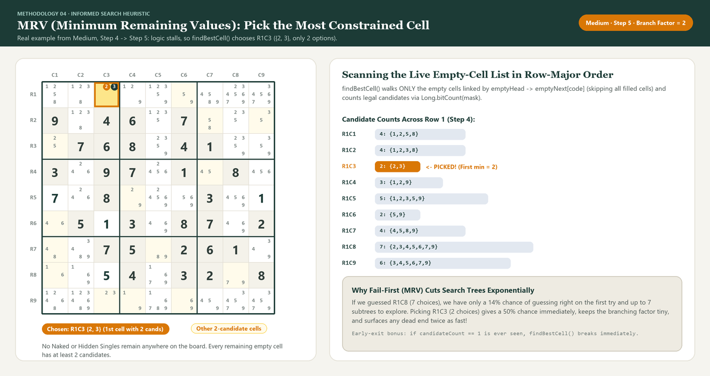

### Step-by-Step Real Example: `Medium`, Step 4 → Step 5

After Step 4 (`R5C9 = 1`), propagation stalls. Look at the candidate counts in Row 1:

- `R1C1`: 4 candidates (`{1, 2, 5, 8}`)
- `R1C2`: 4 candidates (`{1, 2, 3, 8}`)
- **`R1C3`: 2 candidates (`{2, 3}`)** ← **Picked by MRV!**
- `R1C4`: 3 candidates (`{1, 2, 9}`)
- `R1C5`: 5 candidates (`{1, 2, 3, 5, 9}`)
- `R1C8`: 7 candidates (`{2, 3, 4, 5, 6, 7, 9}`)

### Why MRV Shrinks the Search Tree Dramatically

- Guessing on `R1C8` (7 choices) gives only a **14% chance** of guessing right on the first try and creates up to 7 subtrees to explore.
- Guessing on `R1C3` (2 choices: `2` or `3`) gives a **50% chance** immediately, keeps the branching factor at `2`, and exposes any false assumption much sooner!
- **How `findBestCell()` implements MRV in minimal time:** It walks _only_ the **Live Empty-Cell Doubly Linked List** (`emptyHead` → `emptyNext[code]`), counts bits with `Long.bitCount(candidateMask(row, col))`, and exits early if `candidateCount == 1` is ever encountered.

---

## 7. Methodology 5: Dual Contradiction Detection (Fail-Fast)

The faster a solver realizes a guess was wrong, the less dead-end work it does. Inside `propagate()`, **two different checks** catch impossible states the moment they happen:

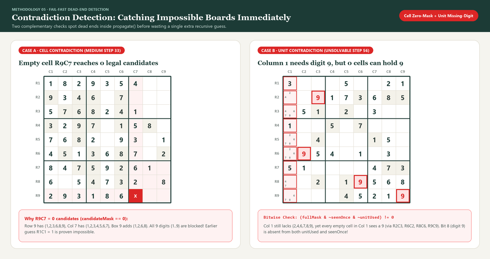

### Case A — Cell-Level Contradiction (`candidateMask == 0`)

_Real example from **Medium, Step 33 (`R9C7`)**:_
After guessing `R1C3 = 2` (Depth 1) and `R1C1 = 1` (Depth 2), propagation fills Steps 10–32. Suddenly `R9C7` gets queued and checked:

- `Row 9` already has `{1, 2, 3, 6, 8, 9}`
- `Col 7` already has `{1, 2, 3, 4, 5, 6, 7}`
- `Box 9` reinforces `{1, 2, 6, 8}`
- Together, **all 9 digits `{1..9}` are blocked**, so `candidateMask(R9C7) == 0` (`000000000`). **Zero legal options remain!** Propagation halts immediately.

### Case B — Unit-Level Missing-Digit Contradiction (`(fullMask & ~seenOnce & ~unitUsed) != 0`)

_Real example from **Unsolvable Test, Step 56 (`Column 1`)**:_
Even when **every empty cell still has 2+ candidates**, an entire unit can already be doomed! Look at Column 1 at Step 55:

- Already placed (`unitUsed`): `{1, 3, 5}` (`R1C1=3, R4C1=1, R7C1=5`)
- Empty cells have candidates: `R2C1:{2,4}`, `R3C1:{4,6,7,8}`, `R5C1:{2,6,7,8}`, `R6C1:{2,6,7,8}`, `R8C1:{4,7}`, `R9C1:{6,7,8}`
- `seenOnce` = `{2, 4, 6, 7, 8}`
- Notice **Digit `9`** is missing from Column 1, yet **every empty cell in Column 1 sees a `9`** (`R2C3=9` in Box 1, `R6C2=9` in Box 4, `R8C6=9` in Row 8, `R9C9=9` in Row 9)!
- In **one bitwise line**, `checkHiddenSingles()` checks:
  ```java
  if ((fullMask & ~seenOnce & ~unitUsed) != 0L) return false;
  ```
  Bit 8 (Digit `9`) lights up immediately — **caught before even one extra cell is searched!**

---

## 8. Methodology 6: Recursive Backtracking & the LIFO Undo Log

When `propagate()` returns `false` (Contradiction), the solver must **backtrack** — erasing the failed guess _and every forced move that cascaded from it_ — and try the next candidate.

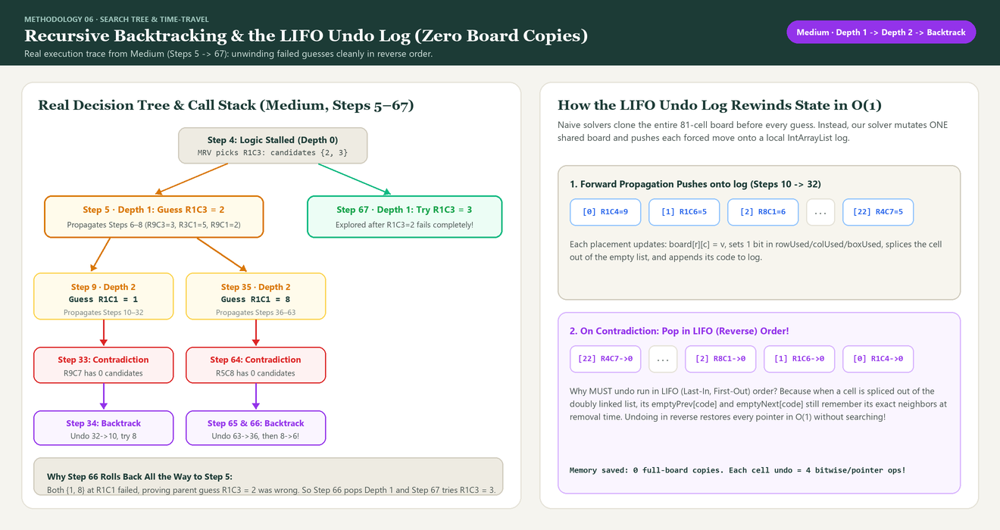

### Step-by-Step Real Execution Trace: `Medium`, Steps 5 → 67

1. **Step 5 (Depth 1):** Guess `R1C3 = 2` (from `{2, 3}`). Propagates Steps 6–8 (`R9C3=3, R3C1=5, R9C1=2`).
2. **Step 9 (Depth 2):** Logic stalls again; MRV picks `R1C1` (`{1, 8}`). Try `R1C1 = 1` first. Propagates Steps 10–32 (`log` records 23 cells).
3. **Step 33 (Contradiction):** `R9C7` hits 0 candidates!
4. **Step 34 (Backtrack Depth 2):** `undo(board, log)` unwinds Steps 32 down to 10 in reverse order, then unplaces `R1C1 = 1`.
5. **Step 35 (Depth 2, Next Option):** Try `R1C1 = 8`. Propagates Steps 36–63.
6. **Step 64 (Contradiction):** `R5C8` hits 0 candidates!
7. **Steps 65 & 66 (Cascading Backtrack):** Depth 2 undoes Steps 63–36 and unplaces `R1C1 = 8`. Because **all candidates `{1, 8}` at `R1C1` failed**, the solver proves parent guess `R1C3 = 2` was wrong — so Step 66 also pops Depth 1 and undoes Steps 8–6!
8. **Step 67 (Depth 1, Next Option):** Solver cleanly tries `R1C3 = 3` and continues toward the final solution!

### Why the LIFO Undo Log Beats Board Copying

A typical backtracking solver copies all 81 integers (`board.clone()`) at every guess depth. Instead, our solver mutates **one single board** in place and passes a tiny local `IntArrayList log` into `propagate()`:

- Every propagated placement calls `log.add(cellCode)`.
- When rolling back, `undo(board, log)` iterates **backwards (`i = log.size() - 1` down to `0`)**.
- **Why LIFO (reverse) order is essential:** When a cell is spliced out of the doubly linked empty list during `place()`, its `emptyPrev[code]` and `emptyNext[code]` fields still hold the exact neighbors that surrounded it at that moment. Restoring cells in exact **Last-In, First-Out** order guarantees those neighbor links are valid again, allowing `restoreEmptyCell(code)` to splice every cell back into its original position in **O(1)**!

---

## 9. Under the Hood: All 11 Core Algorithmic Optimizations

Here is how all **11 optimizations** in [SudokuSolverOptimized.java](SudokuSolverOptimized.java) work together to eliminate redundant scans, divisions, and heap allocations:

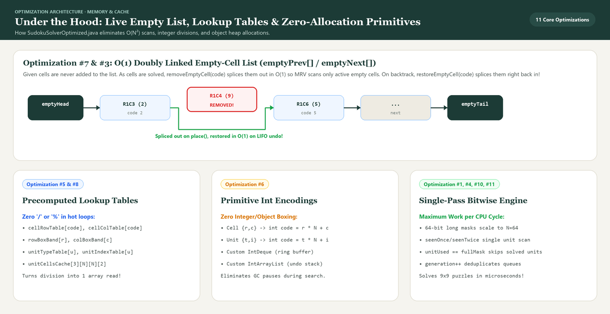

| #   | Optimization                              | What Naive Code Does                                    | What Our Solver Does Instead                                                                  | Code Location                                    |
| --- | ----------------------------------------- | ------------------------------------------------------- | --------------------------------------------------------------------------------------------- | ------------------------------------------------ |
| 1   | **Candidate Bitmasks**                    | `boolean[9]` or `HashSet` per cell                      | Single 64-bit `long` mask (`rowUsed`, `colUsed`, `boxUsed`) supporting up to `N = 64`         | `candidateMask()`, `markUsed()`                  |
| 2   | **Worklist Propagation**                  | Rescans all 81 cells & 27 units every loop              | `cellQueue` & `unitQueue` examine only peers/units touched by recent placements               | `propagate()`, `enqueuePeers()`                  |
| 3   | **LIFO Undo Log**                         | Clones entire `int[N][N]` board per recursion           | Appends packed `cellCode` to `IntArrayList log` and reverses changes in O(1)/cell             | `undo()`, `unplace()`                            |
| 4   | **`seenOnce`/`seenTwice` Hidden Singles** | Inner loop over digits `1..N` + frequency array         | Two bitmasks detect all hidden singles & missing-digit unit errors in 1 pass                  | `checkHiddenSingles()`                           |
| 5   | **Precomputed Unit Lookups**              | Recomputes row/col/box cell coordinates repeatedly      | Static `unitCellsCache[3][N][N][2]` built once in constructor                                 | `buildUnitCellsCache()`                          |
| 6   | **Primitive Int Encodings**               | `Integer` boxing, `int[]` tuples, `ArrayDeque<Integer>` | Packs `{r,c}` and `{unitType, unitIndex}` into `int` codes + custom `IntDeque`/`IntArrayList` | `encodeCell()`, `IntDeque`, `IntArrayList`       |
| 7   | **Live Empty-Cell Doubly Linked List**    | MRV scans all `N²` cells including filled ones          | `emptyHead` / `emptyPrev[]` / `emptyNext[]` splices filled cells out in O(1)                  | `initEmptyCellList()`, `findBestCell()`          |
| 8   | **Precomputed Band & Coordinate Tables**  | `/` and `%` integer divisions inside hot loops          | `cellRowTable`, `cellColTable`, `rowBoxBand`, `colBoxBand`, `unitTypeTable`, `unitIndexTable` | Constructor + `boxIndex()`                       |
| 9   | **Filled-Peer Skipping**                  | Enqueues all 20 peers even if already solved            | `if (board[row][col] != 0) return;` filters out solved cells before queueing                  | `enqueueCellIfNeeded()`                          |
| 10  | **Complete-Unit Early Exit**              | Scans units that already have digits `1..N`             | `if (unitUsed == fullMask) return true;` bypasses full units in 1 comparison                  | `checkHiddenSingles()`                           |
| 11  | **Worklist Generation Deduplication**     | Clears `boolean[81]` `visited` arrays each round        | Increments `currentGeneration++` and compares `cellPendingGeneration[code]`                   | `enqueueCellIfNeeded()`, `enqueueUnitIfNeeded()` |

---

## 10. End-to-End Architecture & Puzzle Benchmarks

Putting everything together, here is the complete execution pipeline from `solve(board)` to `SOLVED` or `UNSOLVABLE`:

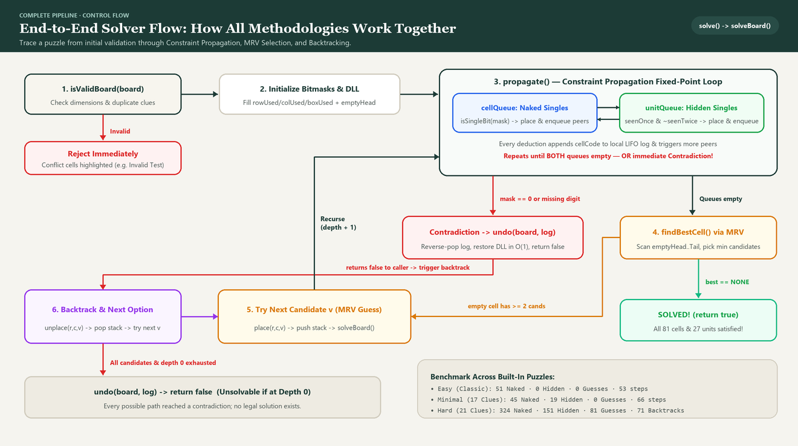

### Verified Trace Metrics Across All 6 Built-In Puzzles

The table below lists exact counts produced by the embedded solver engine in [SudokuVisualizer](SudokuVisualizer.html):

| Built-In Puzzle        | Starting Clues | Total Steps | Naked Singles | Hidden Singles | MRV Guesses | Contradictions | Backtracks | Max Depth | Outcome                                   |
| ---------------------- | -------------: | ----------: | ------------: | -------------: | ----------: | -------------: | ---------: | --------: | ----------------------------------------- |
| **Easy (Classic)**     |             30 |          52 |            51 |              0 |           0 |              0 |          0 |         0 | Solved (pure Naked Singles)               |
| **Medium**             |             30 |         231 |           186 |              4 |          18 |              9 |         13 |         5 | Solved (Deduction + MRV + Backtracking)   |
| **Hard**               |             21 |         666 |           324 |            151 |          81 |             38 |         71 |        13 | Solved (Deep MRV search tree)             |
| **Minimal (17 Clues)** |             17 |          65 |            45 |             19 |           0 |              0 |          0 |         0 | Solved (0 guesses despite 17 clues!)      |
| **Unsolvable Test**    |             18 |          58 |            21 |             30 |           2 |              2 |          2 |         1 | Exhaustive proof: No legal solution       |
| **Invalid Test**       |             30 |           0 |             0 |              0 |           0 |              — |          0 |         0 | Rejected upfront (duplicate `5` in Row 1) |

_(Note: `Backtracks` can exceed `Contradictions` because when every candidate at a guess node fails, popping back out of that parent guess also records a backtrack step.)_

---

## 11. Repository Authors

### Authors & Research Team

| #   | Author                         | Role                         | Technical Focus                                                                                                                    |
| --- | ------------------------------ | ---------------------------- | ---------------------------------------------------------------------------------------------------------------------------------- |
| 1   | **Shivraj Vijay More**         | Heuristics & Search Engineer | Designed the Minimum Remaining Values (MRV) search heuristic, contradiction detection, and the live execution step recorder        |
| 2   | **Dhanalakshmi Shrimant Kare** | Lead Algorithm Architect     | Engineered the 64-bit candidate bitmasks, O(1) doubly linked empty-cell list, LIFO undo log, and worklist generation deduplication |
| 3   | **Nivedita Sanjay Pawar**      | Constraint Specialist        | Formulated `seenOnce`/`seenTwice` bitmask detection for naked & hidden singles, precomputed unit tables, and filled-peer skipping  |

> _"A wish once imagined is now becoming a reality — Kitty🐾"_  
> **Copyright © 2026: All Rights Reserved.**

---
